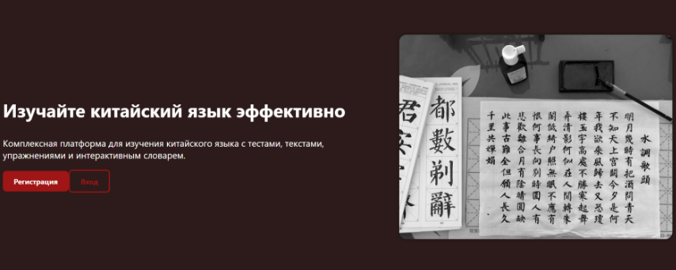

# 📚 Chinese Learning Platform

Проект демонстрирует реализацию уроков по китайскому языку со словарём, тестами, тестами и упражнениями для разных уровней и на разнве темы

---

## 📖 О проекте

**Chinese Learning Platform** — это полноценное клиент-серверное веб-приложение, созданное для тех, кто изучает китайский язык. Платформа объединяет в себе словарь с фильтрацией, библиотеку текстов с переводом, тесты по уровням и интерактивные упражнения.

Проект построен на современном стеке технологий и поддерживает регистрацию и авторизацию пользователей.

---

## 🖼 Шапка главной страницы

---

## ✨ Возможности

### 🔐 Аутентификация
- Регистрация новых пользователей
- Авторизация с защитой сессий
- Хранение пользовательских данных в MongoDB

### 🏠 Главная страница
- Привлекательный дизайн и интуитивная навигация
- Быстрый доступ ко всем разделам платформы
- Информация о возможностях сайта

### 📕 Словарь
- Отображение слов, хранящихся в базе данных
- Сортировка по **уровням** (HSK 1–6 и др.)
- Сортировка по **темам** (еда, путешествия, работа и т.д.)
- Сортировка по **частям речи** (существительное, глагол, прилагательное и др.)
- Удобный просмотр иероглифов, пиньиня и перевода

### 📄 Тексты
- Библиотека текстов на китайском языке
- Встроенный перевод
- Сортировка по уровню сложности и тематике

### 📝 Тесты
- Тесты по разным уровням владения языком
- Проверка знаний в интерактивной форме
- Мгновенный результат

### 🏋️ Упражнения
- Разнообразные типы заданий
- Сортировка упражнений по видам
- Практика лексики и грамматики

---

## 🛠 Технологический стек

| Слой | Технологии |
|------|------------|
| **Frontend** | JavaScript, React, HTML, CSS |
| **Backend** | Node.js, Express |
| **База данных** | MongoDB |
| **Аутентификация** | JWT / сессии |

---

## Быстрый старт

`npm start` на бэке и на фронте 
 
